# Riaya (رعاية)

**A private front door to men's reproductive health, built for Abu Dhabi.**

Men in Abu Dhabi usually reach fertility care late: after months of trying, and after their wife has already been assessed. Riaya lets a man check the everyday things that affect his reproductive health privately, in Arabic or English, by voice, chat, his watch or WhatsApp. It explains every signal with published evidence. It then sends him to the right level of care, with a licensed doctor approving every specialist referral. The coordinator books the clinic visit and it is followed through to attendance. It is a screening tool, not a diagnosis.


**Watch the full demo (2:40, narrated):** [docs/media/riaya-demo.mp4](docs/media/riaya-demo.mp4)

## How it works


1. **He checks privately.** Voice, chat, form, watch data or WhatsApp. He gives no name, phone number or ID.
2. **Riaya explains.** Every signal links to graded, cited evidence. Missing data is shown as unknown, never as normal.
3. **A doctor approves.** Guideline rules suggest a level of care, and a licensed doctor approves or changes it. A reason is required for any change.
4. **Care Connect books the visit.** He picks a clinic, and a coordinator agrees a time with that clinic. He gets a discreet calendar entry, and his summary goes to the clinic with a one-time code.
5. **The loop closes.** Attendance, missed visits and the reasons for them feed the clinician and programme dashboards.
6. **Results and habits over time.** Lab Intelligence keeps every result against its own lab's range, and a doctor checks what was read. A 12-week companion tracks the habits he chose, because sperm take about three months to develop.

## Features

Each feature is listed with what it does, how it is built, and a screenshot from the running app. The screenshots are captured against a fresh database by `demo/screenshots.js` and `demo/screenshots_labs_plan.js`.

### For the man

| Feature | What it does | How it's built | Screenshot |
|---|---|---|---|
| **Arabic-first landing** | Arabic by default with one-tap English. Wording chosen with cultural and religious sensitivity in mind ([docs/CULTURAL_DESIGN.md](docs/CULTURAL_DESIGN.md)). The public demo shows a banner because it is not UAE-hosted. | `web/index.html`, `web/js/app.js` and `web/js/i18n.js` (English and Arabic text). Right-to-left layout with self-hosted Noto Kufi Arabic and IBM Plex fonts. The banner follows `uae_hosted` from `/api/config`. | 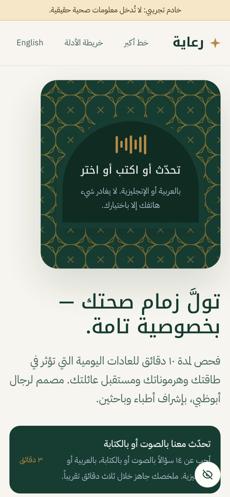 |
| **Plain-language consent** | Says what is kept and what is never done. A separate choice for doctor review, device data and research. | `POST /api/consent` saves one row per purpose, with version and time, in the `consents` table. Doctor-review consent sets `review_consent` on each check, which controls what doctors can open. | 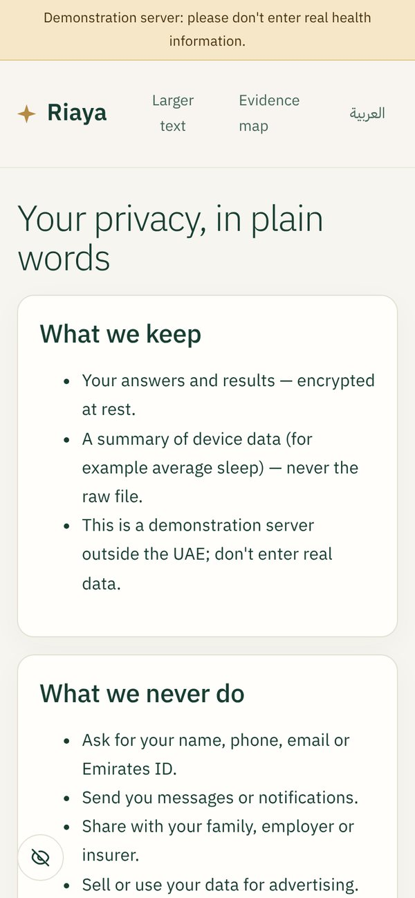 |
| **Voice and chat check** | 14 questions by voice or text. Understands Gulf Arabic, standard Arabic and English, including spoken numbers. | `web/js/chat.js` runs the conversation. `web/js/nlu.js` parses Gulf Arabic answers and numbers. `web/js/voice.js` uses the phone's speech recognition, or Whisper through transformers.js inside the browser, so audio never leaves the phone. | 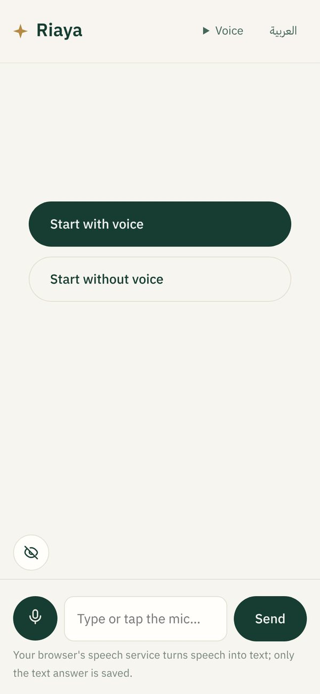 |
| **Detailed check** | Validated instruments: PSS-4, PHQ-2, AUDIT-C, STOP-Bang, ADAM. Each field shows its unit and plausible range. | `backend/app/questionnaire.py` serves the form. Scoring is in `features.py`. Pydantic validates every answer, and a custom handler turns errors into plain sentences. | 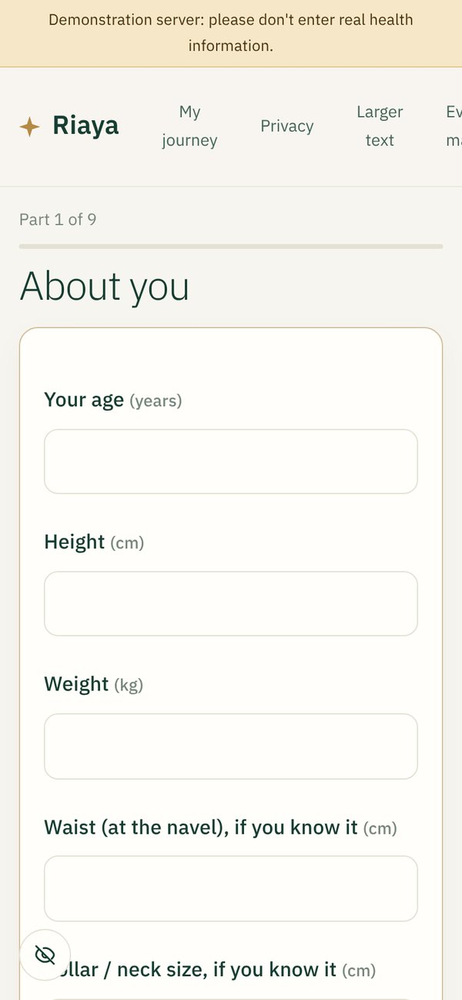 |
| **Watch and sensor data** | Apple Health export, Dexcom or Libre glucose CSV, or a daily CSV. Compared with his own baseline. | `backend/app/wearables.py` streams `export.xml` with `iterparse` and refuses over-compressed archives. It compares the last 7 days with earlier weeks. Only an encrypted summary is kept, never the file. | 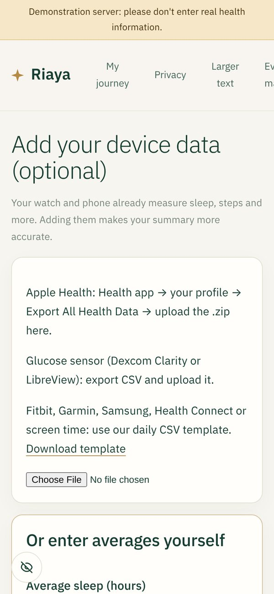 |
| **Lab report reader** | Reads a semen-analysis or hormone report (PDF, text or photo) and shows each value with: the lab's own range, any H/L flag, how sure the reading is, and the line it was read from. Also picks up abstinence days, sample time and fasting. He checks everything before saving. | `backend/app/labreport.py`. **Table-aware:** it spots a results table header and handles values split across lines. **Ranges:** `8.6 - 29.0`, `>= 16` and `< 5.7` styles are converted to the app's units. **Confidence score:** based on whether a unit and range were found, the table layout, how specific the label is, and whether the value is plausible. Photos are read on the phone with tesseract.js (Arabic and English). The file is never stored. | 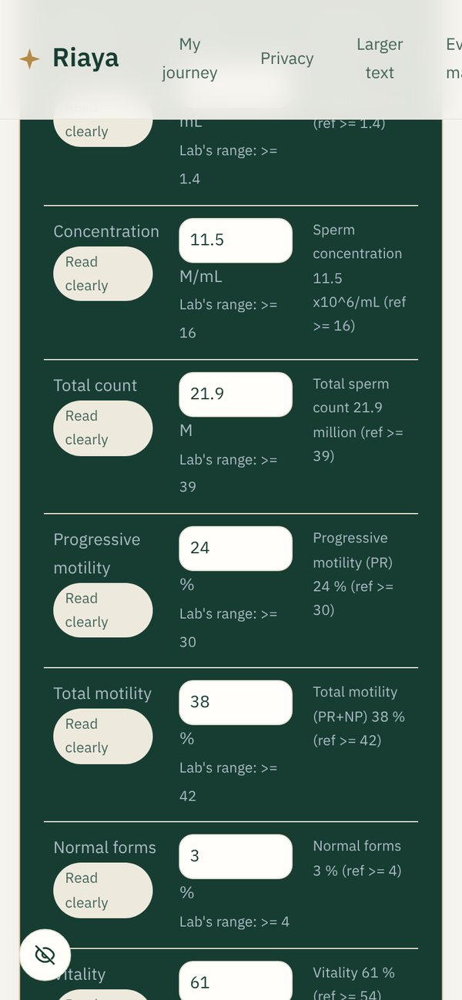 |
| **My lab results (timeline)** | Every saved result over time. Each one is judged against the range printed on its own report. Shows: change since last time, the lab's limit on the chart, collection warnings, when guidelines advise a repeat test, and a warning when results come from different labs. | `backend/app/labintel.py`, `/api/me/labs`. Each value is stored encrypted in `lab_results`. WHO 2021 limits are used only when a report prints no range. **Collection checks:** abstinence of 2–7 days (WHO 2021); a fever in the last 3 months; testosterone taken before 10 am and fasting (AUA 2018, Endocrine Society 2018). The chart is inline SVG with a table view. | 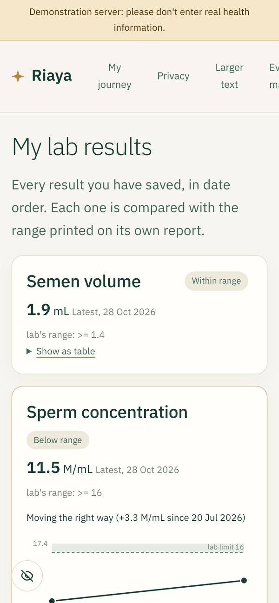 |
| **12-week plan: choose goals** | He picks up to three everyday habits from his own summary, each with one concrete action. A doctor reviews the plan first if he agreed to doctor review; otherwise it is self-guided. | `backend/app/companion.py`. Options come from his summary's plan (`plan.py`), ranked by how much each habit adds to his signal (Shapley). Medical items such as sleep apnoea or varicocele are left to the doctor, not made into weekly goals. | 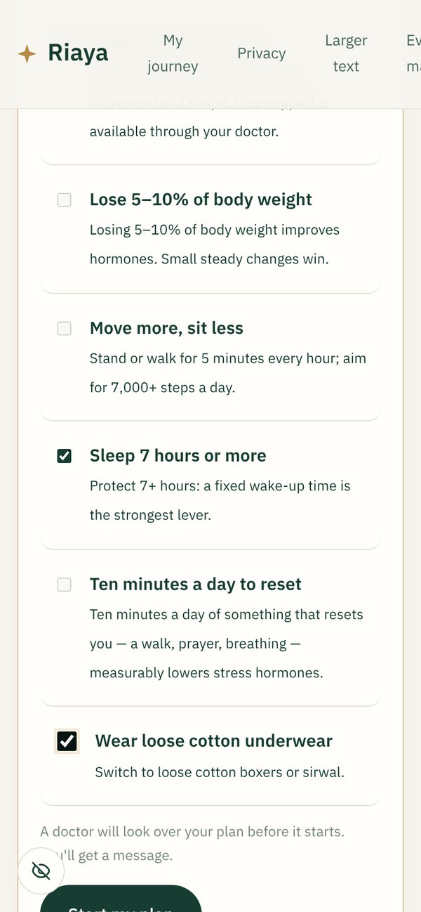 |
| **12-week plan: weekly check-in** | Each week: how it went for each goal (not this week, a few days, most days, every day), a number where one helps (cigarettes, sleep hours, weight), and his energy. Shows his doctor's note. | `POST /api/me/plan/checkin`. The week is counted from the approval date. He can record this week or catch up on last week. Numbers are range-checked with plain error messages. Check-ins are stored encrypted in `checkins`. | 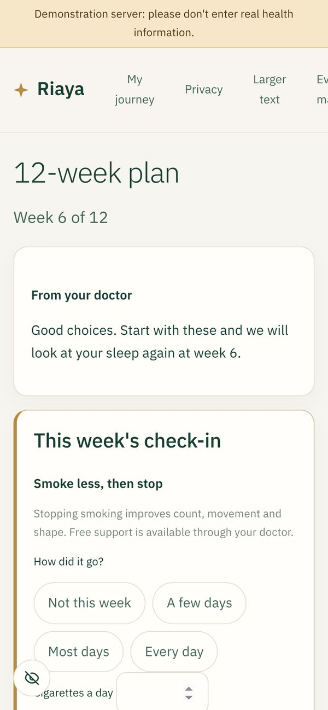 |
| **12-week plan: trends and reminders** | Bars for each week, weeks logged, and first versus latest number. An optional weekly reminder says only "Weekly check-in". At week 12 he is offered a follow-up check. | Inline SVG bars in `web/js/app.js`. The reminder is a `.ics` file with `RRULE:FREQ=WEEKLY` for the remaining weeks, at 8 pm Gulf time, with no health words. | 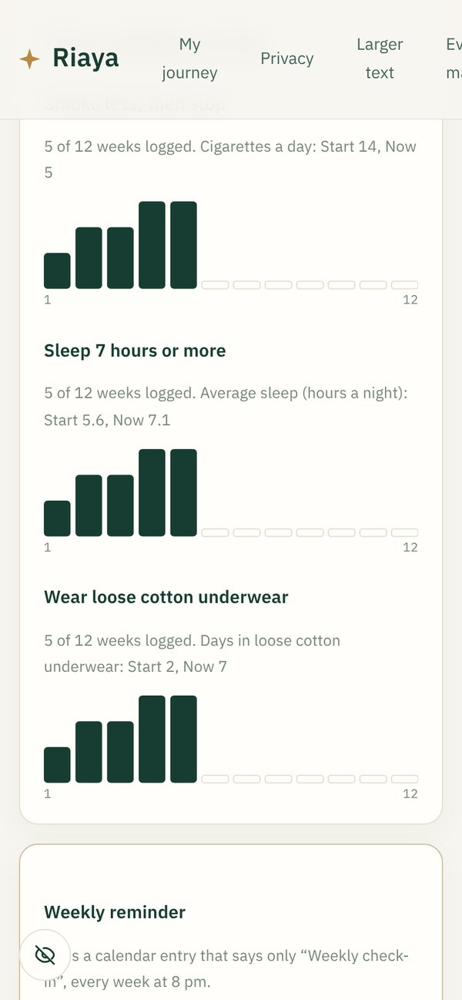 |
| **Private summary** | The next step, and for each finding: what was seen, why it matters, evidence grade, sources, one recommendation and its limits. Also contradiction checks and a what-if simulator. | `backend/app/assessment.py` combines several parts. `knowledge.py` spreads evidence over the graded map. `ml.py` adds Shapley attribution and two models. `recommend.py` builds the cards, contradictions and what-if, and `triage.py` picks the level of care. | 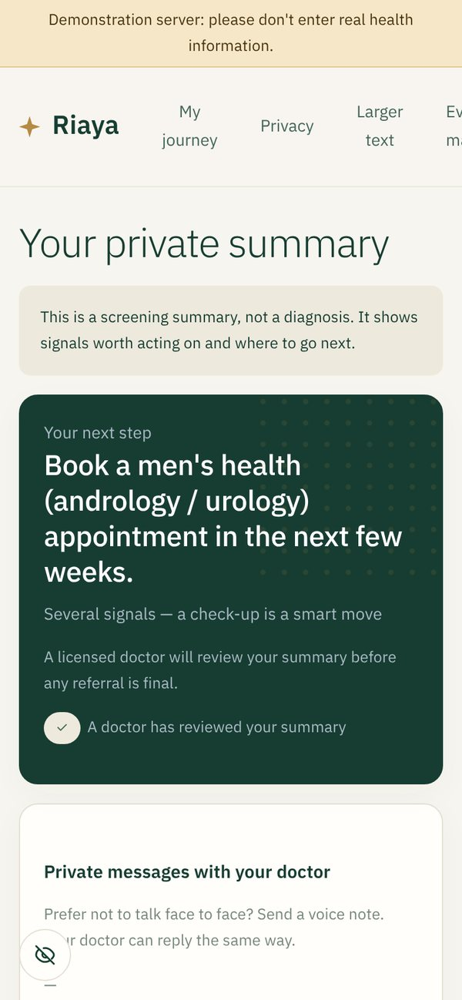 |
| **My journey** | Every check, what changed since last time, tests already done, the referral timeline, and a reminder for a follow-up check. Links to lab results, the 12-week plan and booking. | `GET /api/me/journey` builds this from each check, its referral steps and a comparison with the previous check (`_changes`). | 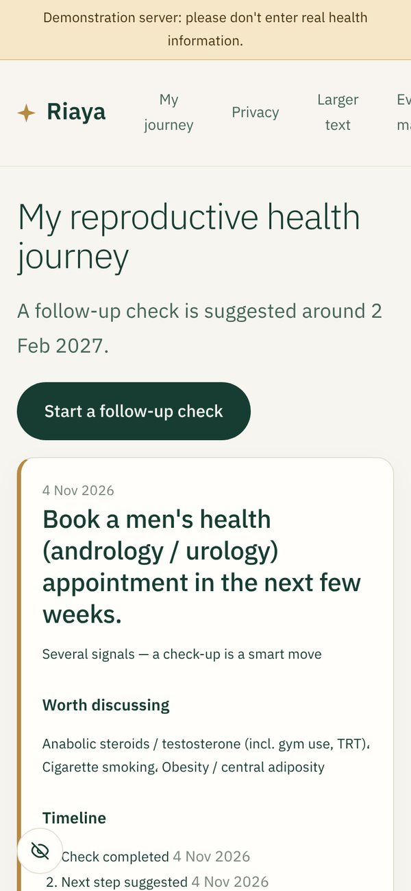 |
| **Care Connect: choose a clinic** | Opens only after a doctor approves. Only clinics that offer the care his referral needs, using public facts from each clinic's own website. Nothing invented. He gives preferred times and how to reach him. | `backend/app/care.py`, `/api/assessments/{id}/care`. The directory is seeded from `knowledge/providers.json` into a `providers` table, and each level of care maps to a kind of service. A clinic is marked confirmed only by a coordinator, with a note. | 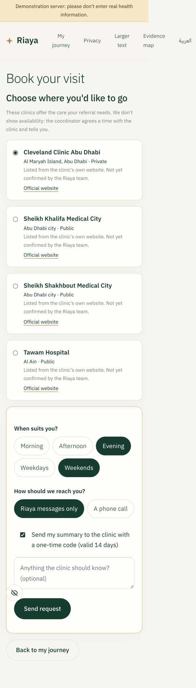 |
| **Care Connect: request sent** | Gives him a one-time handover code for the clinic, valid 14 days. He can cancel. | `POST /api/assessments/{id}/appointment` creates an `appointments` row and a `shares` code. Preferences and any phone number are encrypted. Cancelling revokes the code. | 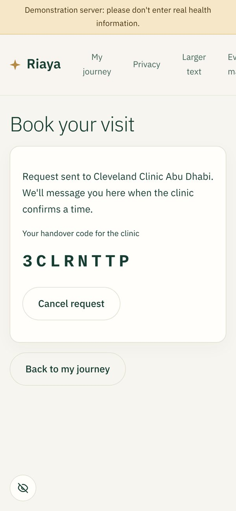 |
| **Care Connect: confirmed** | Shows the date, place and code. A calendar file that says only "Appointment". "I went" or "I couldn't go" with a reason; a missed visit reopens the choice. | `GET /api/assessments/{id}/appointment.ics` produces the calendar file. `POST .../appointment/outcome` records attendance and moves the referral on. | 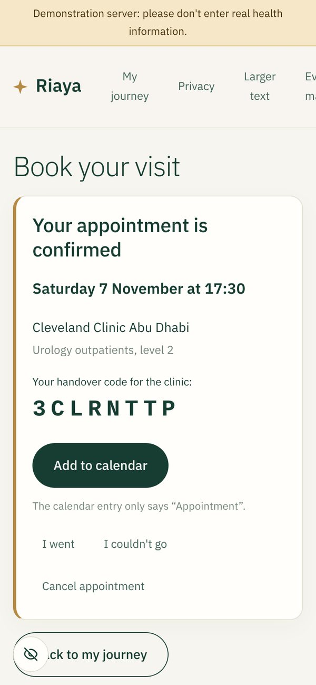 |
| **Privacy and sharing** | Change or withdraw consent at any time. Withdrawing doctor review removes his checks from every doctor's view. Recovery code, download everything, delete everything. | **Withdrawal:** sets `review_consent=0`, takes pending reviews off the queue and revokes share codes. **Recovery code:** about 99 bits, only its hash is stored, it works once, and it signs out the old phone. **Delete:** `DELETE /api/me` erases every table that holds his data. | 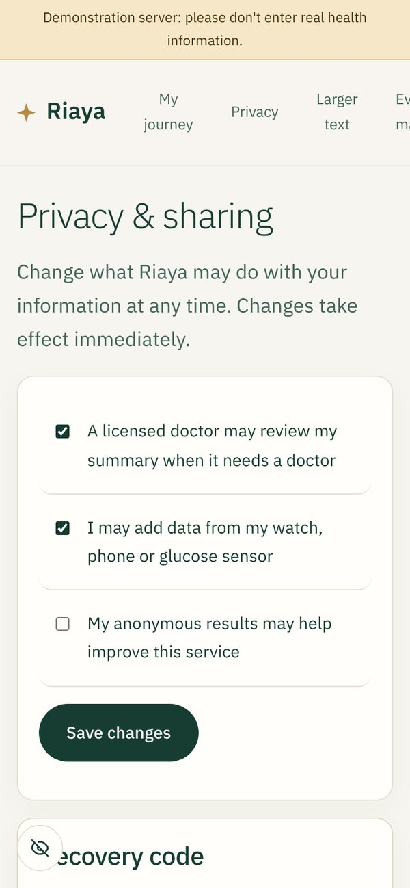 |
| **Partner link** | Shows his wife that he has taken the step, never his answers or results. Expires in 30 days; he can revoke it. | `/api/assessments/{id}/partner-link` stores only a hash of the token. The token sits in the URL fragment, so it is not sent to servers or in Referer headers. `/api/partner/{token}` returns status only. | 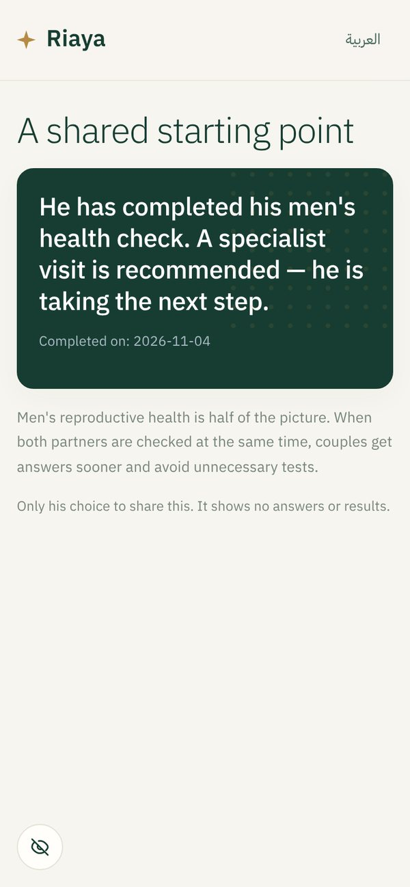 |
| **WhatsApp** | The same check over WhatsApp. Sending "delete" erases everything. A demo runs without a phone. | `backend/app/conversation.py` holds the conversation state. `/api/whatsapp/twilio` checks Twilio's signature. The number is stored only as a salted hash (`RIAYA_PHONE_SALT`). | 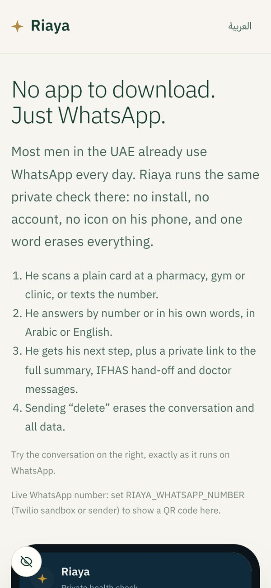 |
| **Clothing check** | Type or photograph a care label to see how much of the garment may warm the groin, with the evidence for each fibre. | `backend/app/fabric.py` parses fibre percentages. Label photos are read on the phone. | 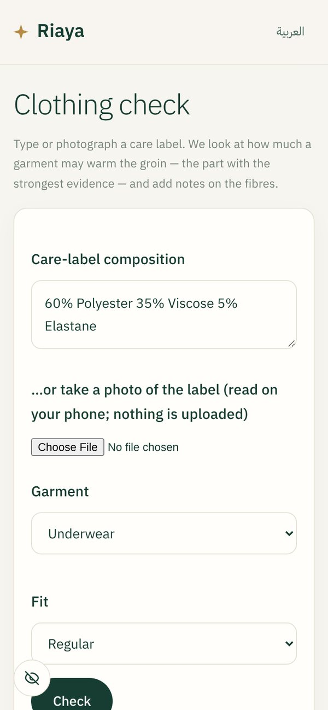 |

### For doctors and coordinators

| Feature | What it does | How it's built | Screenshot |
|---|---|---|---|
| **Secure sign-in** | Locks out after 5 failed attempts. Sessions last 8 hours, or end after 30 minutes idle. No default account in deployment. | PBKDF2-SHA256 with 310,000 rounds. The `login_attempts` table enforces lockouts. A dummy hash makes a wrong username take as long as a wrong password. The `sessions` table holds expiry and last activity. Weak passwords are refused when accounts are provisioned. | 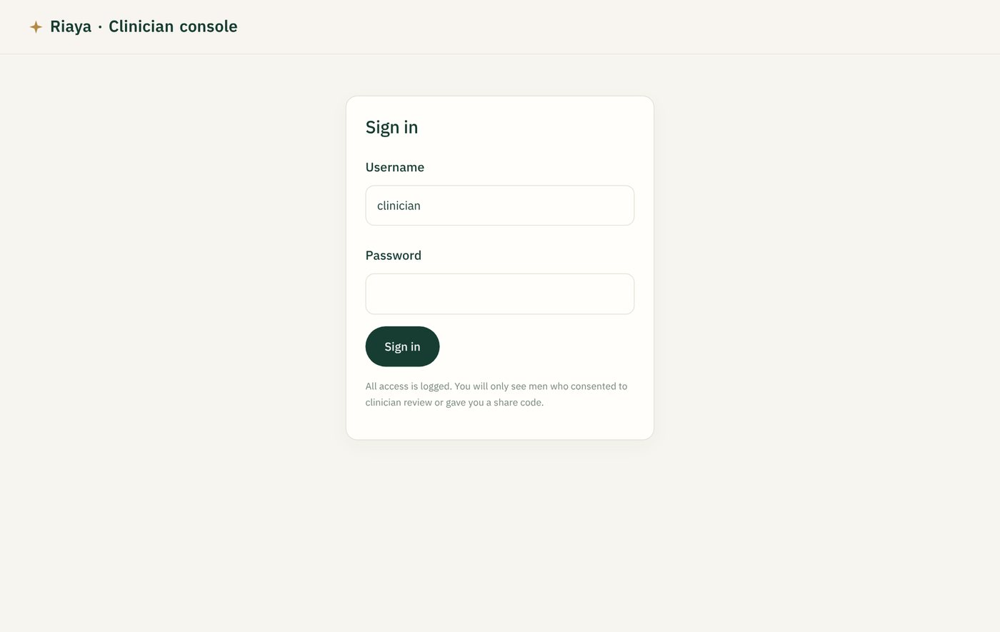 |
| **Review workspace** | A priority queue with review deadlines. Three panels: patient, clinical review, actions. Evidence explorer, approve, change or reject (a reason is required for any change), and messages and voice notes both ways. | `web/js/clinician.js` (`openCase`). `/api/clinician/cases/{id}/review` stores the decision and the reason for any override. Messages and voice notes are encrypted. | 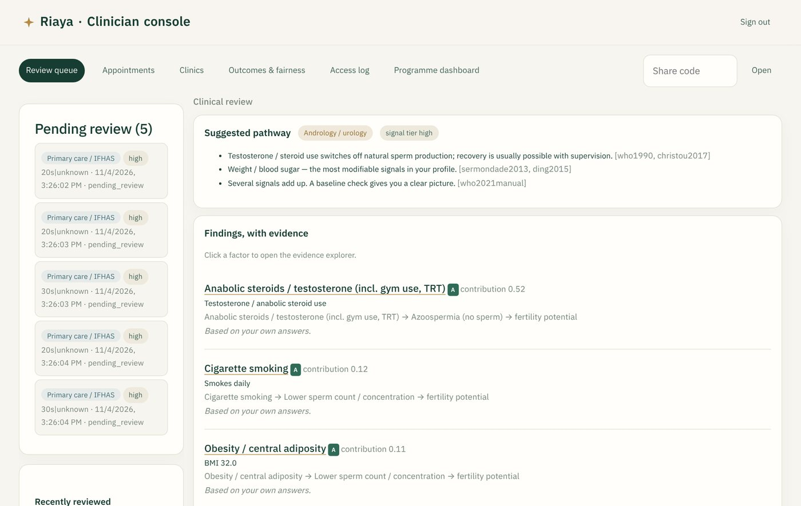 |
| **Lab review** | Each value he saved, beside the line it was read from. Also shows the reading confidence, whether he changed the number, the lab's range and any collection concerns. Accept, correct to what the report says, or set aside. He sees the decision and the reason. | `/api/clinician/labs/pending` and `/api/clinician/labs/{id}`. A reason is required to correct or set aside. The original value is kept beside the correction, and every decision is in the access log. | 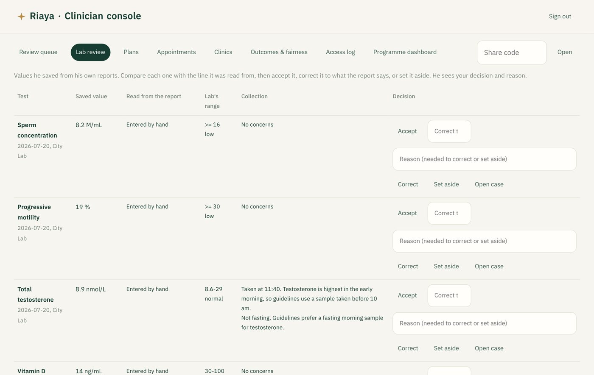 |
| **Plan review** | Proposed 12-week plans. Untick a goal and add a note he will see, or approve as proposed. Approval starts week 1 and messages him in his language. | `/api/clinician/plans/{id}`. A note is required for any change, and at least one goal must remain. | 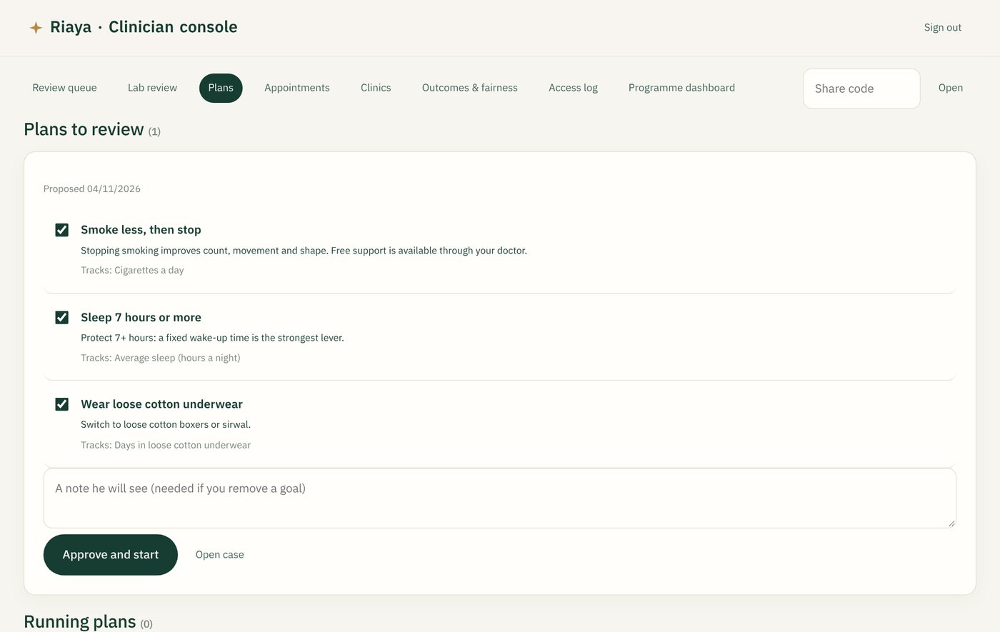 |
| **Running plans** | For each goal: weeks logged, share of the last 4 weeks kept, and first versus latest number. Flags a check-in that is due. | Summaries are worked out from the stored check-ins in `companion.plan_view`. | 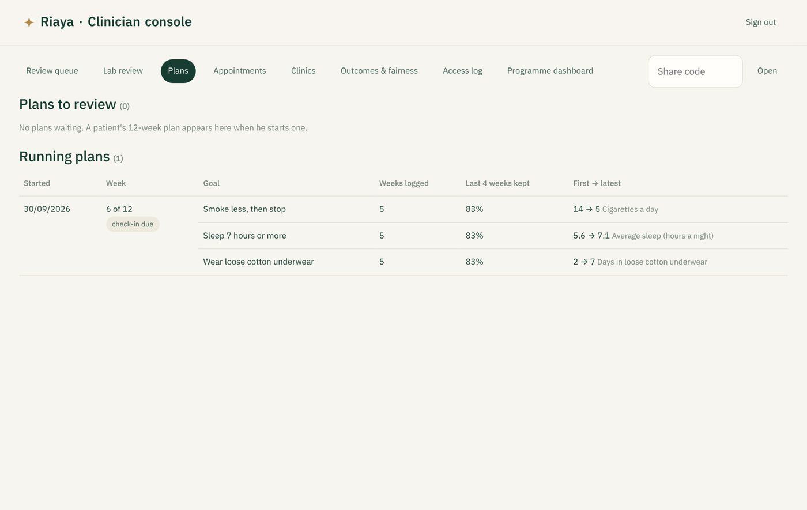 |
| **Appointment requests** | The clinic, level of care, preferred times, contact method and handover code. Confirm the time agreed with the clinic, or decline with a reason. | `/api/clinician/appointments/{id}`. Confirming books the referral and messages him. Declining revokes the code and lets him choose again. | 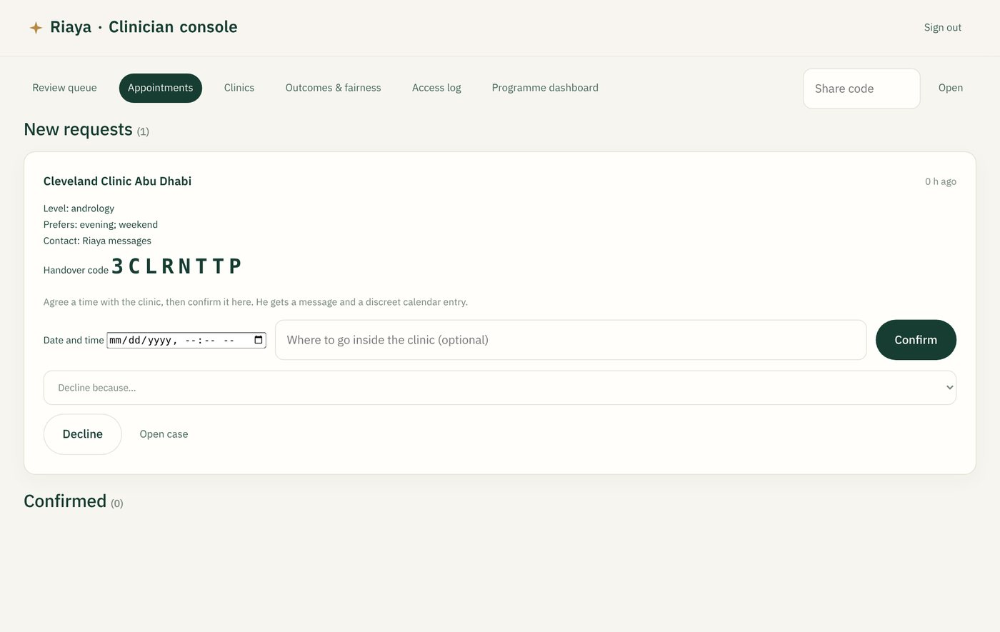 |
| **Confirmed visits** | Mark each visit attended, or missed with a reason. | Updates the `appointments` and `referrals` rows. Reasons feed the metrics. | 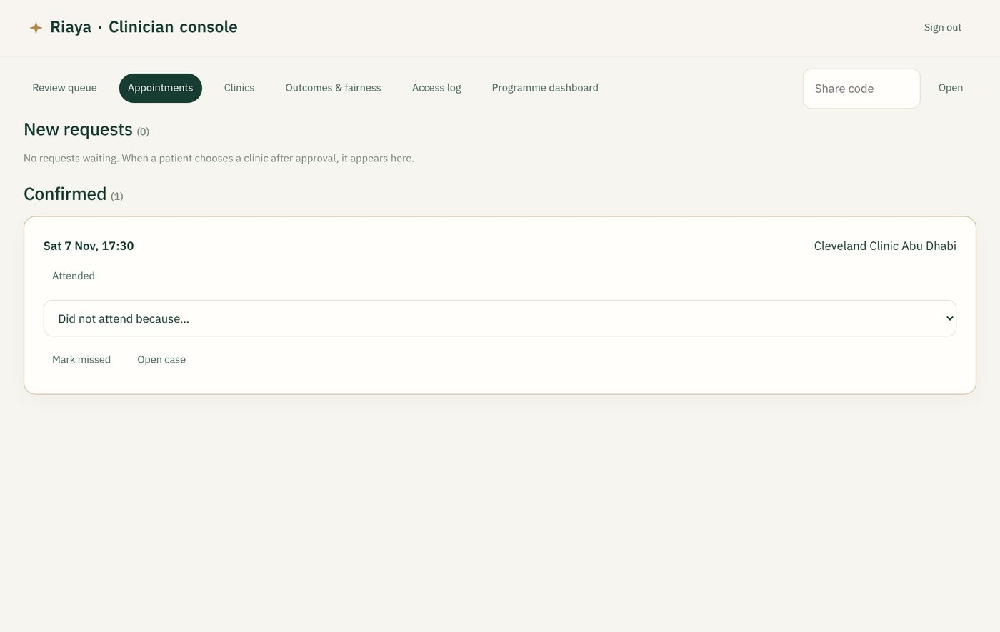 |
| **Clinic directory** | Add a clinic with only its public facts. Confirm it with a note on how it was checked, which patients see. Hide a clinic from patients. | `/api/clinician/providers`. A website must be `https://`. A confirmation note of at least 10 characters is required. | 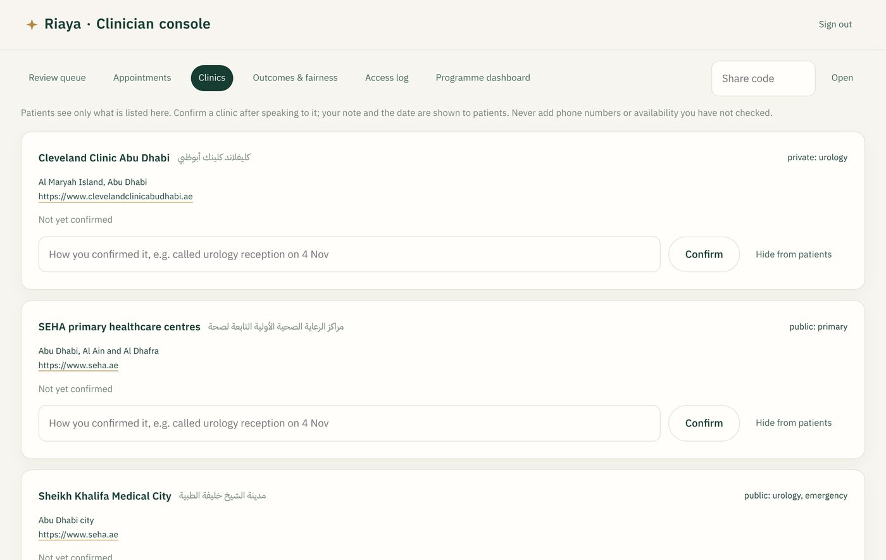 |
| **Outcomes and fairness** | Completion, time to review and to evaluation, results by age and background, and Care Connect booking and attendance with reasons. | `/api/clinician/metrics` in `main.py`, plus `care.metrics()`. | 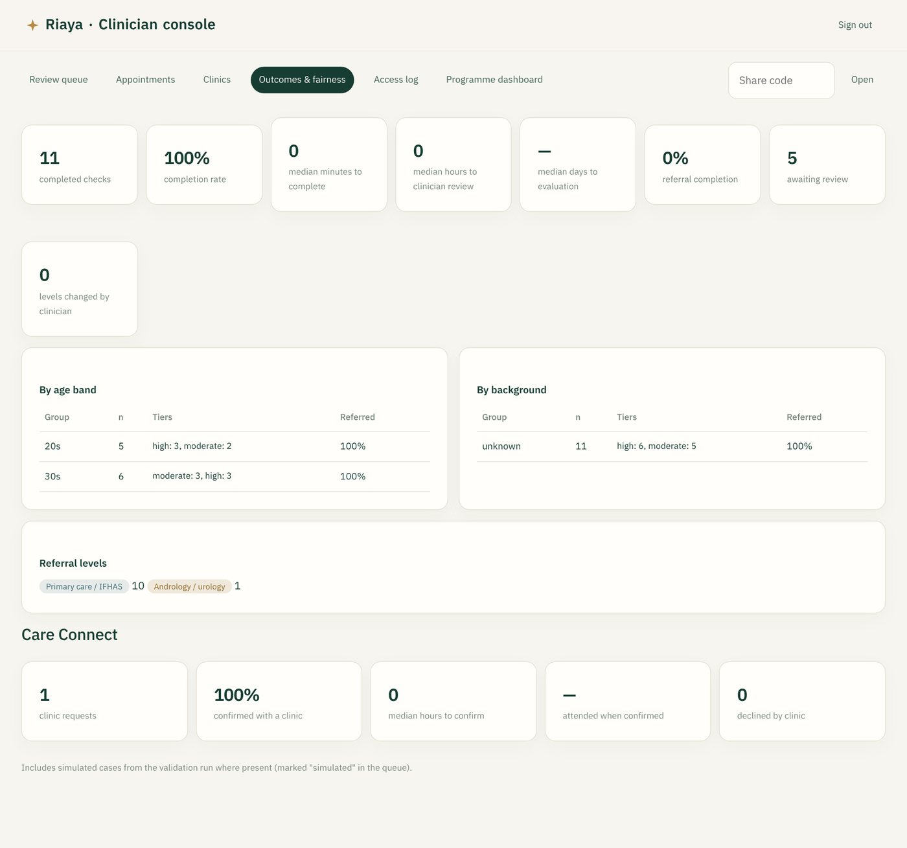 |
| **Access log** | Every sign-in, failure, lockout, case view, lab decision and plan decision. Password change ends other sessions. | `db.audit()` writes to the `audit` table. The access log stores no health content. | 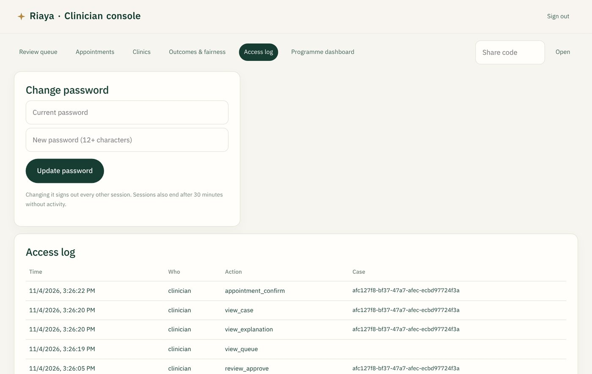 |
| **Programme dashboard** | Aggregated for ADPHC and DoH: funnel, time to care, population drivers, barriers and fairness. Simulated cases are excluded by default. | `backend/app/insights.py`, with k-anonymity: any group smaller than 5 is hidden. | 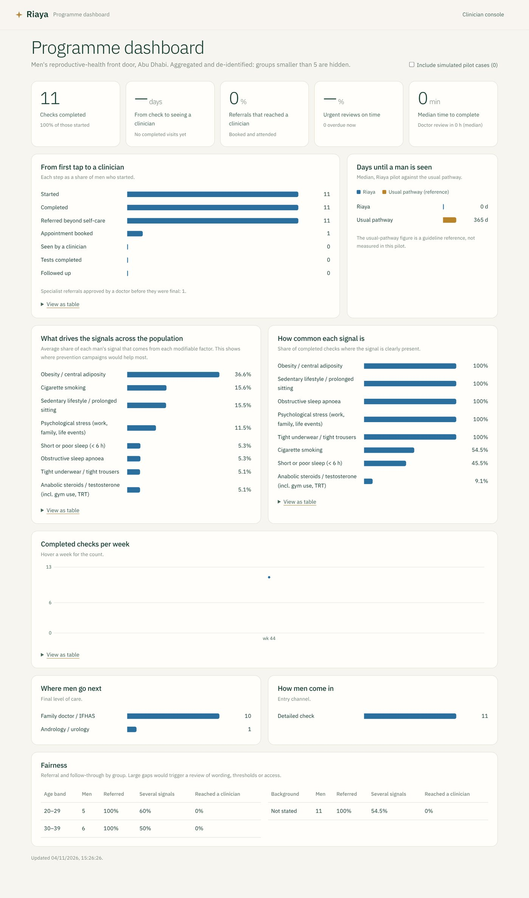 |
| **Evidence map** | 69 factors and 148 cause-and-effect links, each graded A–D and cited from 95 sources. | `knowledge/graph.json`, loaded and checked by `knowledge.py`. The server refuses to start if any link lacks a source. | 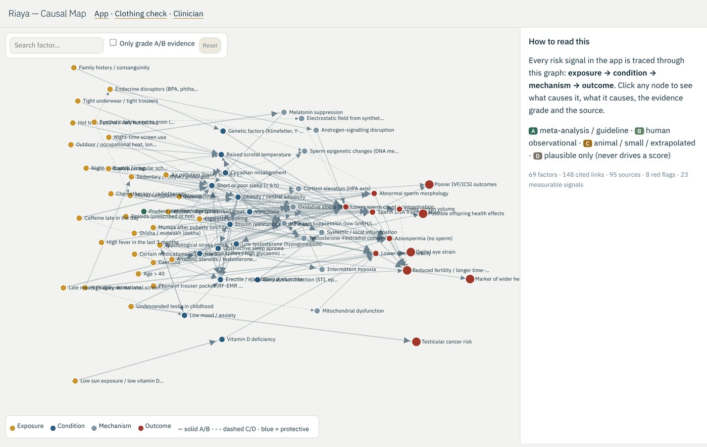 |

### Behind the screens

| Capability | Detail | Code |
|---|---|---|
| Triage | Ordered guideline rules (WHO 2021, AUA/ASRM 2021, EAU 2024, ASRM 2020). Red flags override everything. Genomic flag (karyotype, AZF, CFTR). Rapid review targeted at 24–48 h. | `backend/app/triage.py` |
| Explainability | Shapley attribution over the evidence map; a gradient-boosting model with SHAP; a logistic model on real data (UCI Fertility, n=100) as a second opinion. | `backend/app/assessment.py`, `ml.py` |
| Lab Intelligence | Table-aware extraction with the lab's own ranges and confidence. Collection-context checks, a timeline across reports, repeat-test advice and doctor reconciliation. | `backend/app/labreport.py`, `labintel.py` |
| 12-week companion | Goals from his own summary, doctor review, weekly check-ins, trends and discreet reminders. | `backend/app/companion.py` |
| Contradiction checks | Reported sleep against the watch, "no diabetes" against HbA1c, low testosterone with suppressed LH when no steroid use was reported. Each is shown, never silently hidden. | `backend/app/recommend.py` |
| IFHAS and FHIR hand-off | FHIR R4 bundle: QuestionnaireResponse, Observations with LOINC codes, ServiceRequest. | `backend/app/ifhas.py`, `handover.py` |
| Care Connect | Clinic directory, appointment requests, coordinator decisions, a discreet `.ics` calendar file, and attendance with reasons. | `backend/app/care.py` |
| Privacy controls | Encryption at rest (Fernet). Separate consent per purpose. One-time share codes. Device links expire after 180 days idle. Hide button and auto-blur in the app switcher. | `backend/app/security.py`, `web/js/common.js` |
| Safe uploads | Files are read in chunks with size limits, and over-compressed archives are refused. | `backend/app/main.py`, `wearables.py` |
| Installable app | PWA with an offline app shell. Health data is never cached. | `web/manifest.webmanifest`, `web/sw.js` |

## Tech stack

| Layer | Technology |
|---|---|
| Backend | Python 3.11, FastAPI 0.162, Uvicorn, Pydantic validation with plain-language errors |
| Database | PostgreSQL 16 via psycopg 3 in deployment; SQLite for local runs. One adapter with automatic migrations (`backend/app/db.py`) |
| Security | `cryptography` (Fernet) for encryption at rest, PBKDF2-SHA256 passwords, Content-Security-Policy, HSTS |
| Machine learning | scikit-learn 1.9 (gradient boosting, logistic regression), SHAP 0.54, NumPy, pandas, joblib |
| Documents | pypdf for lab-report PDFs, tesseract.js 5 (Arabic and English OCR, on the phone), table-aware extraction with the lab's own reference ranges |
| Voice | Web Speech API, with Whisper through transformers.js 3 running in the browser as a fallback |
| Frontend | Plain HTML, CSS and JavaScript (no build step). Charts are hand-built inline SVG with table views. Self-hosted Noto Kufi Arabic and IBM Plex fonts. RTL-first layout |
| Messaging | Twilio WhatsApp webhook with signature validation |
| Interoperability | FHIR R4, LOINC, iCalendar (`.ics`) for discreet appointments and reminders |
| Testing and CI | pytest (32 end-to-end API tests), Playwright for UI checks, GitHub Actions on SQLite and Postgres |
| Deployment | Microsoft Azure in a UAE region (`azure/main.bicep`: App Service and PostgreSQL Flexible Server), or the Render blueprint (`render.yaml`) |

## Results

From [validation/REPORT.md](validation/REPORT.md):
- **Rule check, not accuracy:** the team wrote 26 scenarios from WHO, AUA/ASRM and EAU guidance. The triage rules gave the expected next step in all 26, with no case sent to a lower level of care than expected. This shows the rules behave as designed. Clinical accuracy needs independent review by UAE clinicians, which is the first pilot step.
- **Real data** (UCI Fertility, n=100): AUC 0.62–0.69.
- **Simulated cohort** of 20,000 men using effect sizes from the literature: AUC 0.68, with calibration and subgroup fairness tables.
- **Evidence map alone**, with no training, ranks outcomes with AUC 0.66, which shows the map and the literature agree.

The report states the limits plainly:
- the test cases were written by the same team;
- the cohort is simulated;
- the real dataset is small.

## Run it

```bash
python3 -m venv .venv && .venv/bin/pip install -r requirements.txt
```

```bash
RIAYA_ENABLE_DEMO_CLINICIAN=true .venv/bin/uvicorn app.main:app --app-dir backend --port 8000
```

Open http://localhost:8000. The doctor console is at `/clinician.html`. With `RIAYA_ENABLE_DEMO_CLINICIAN=true` the demo login is `clinician` / `demo-clinician`; never enable it on a public deployment. The API docs are at `/api/docs`.

```bash
.venv/bin/python -m pytest -q
```

```bash
.venv/bin/python validation/run_validation.py --seed-demo
```

The first runs the end-to-end tests; set `DATABASE_URL` to run them on Postgres. The second writes the validation report and adds simulated cases to the console.

**Deploy:** `render.yaml` deploys to Render with:

- a managed Postgres database;
- a generated encryption key and phone-hash salt;
- a health check at `/api/health`.

It does not create a default clinician account; Render asks for `RIAYA_CLINICIAN_USER` and `RIAYA_CLINICIAN_PASSWORD`. Do not collect real patient data until all of these are confirmed:

- UAE hosting (`RIAYA_UAE_HOSTED=true` only then);
- health-data compliance;
- clinical governance;
- security review.

Settings, backups and restores are covered in [docs/OPERATIONS.md](docs/OPERATIONS.md).

| Setting | Purpose |
|---|---|
| `DATABASE_URL` | Postgres instead of SQLite |
| `RIAYA_DATA_KEY` | Encryption key; keep it apart from backups |
| `RIAYA_CLINICIAN_USER`, `RIAYA_CLINICIAN_PASSWORD` | First doctor account (only created if the password is strong) |
| `RIAYA_UAE_HOSTED` | `true` only on a UAE deployment approved for health data; removes the demo banner |
| `RIAYA_VIDEO_BASE` | Self-hosted video service; video stays off without it |
| `TWILIO_AUTH_TOKEN`, `RIAYA_WHATSAPP_NUMBER`, `RIAYA_PUBLIC_URL` | WhatsApp channel |

## Docs

- [docs/RESEARCH_VERIFICATION.md](docs/RESEARCH_VERIFICATION.md): every claim checked, including corrections to the brief
- [docs/REFERENCES.md](docs/REFERENCES.md): all 95 sources, with links and what each one supports
- [docs/CULTURAL_DESIGN.md](docs/CULTURAL_DESIGN.md): each cultural and religious barrier, and how the product handles it
- [docs/SYSTEM_LAYERS.md](docs/SYSTEM_LAYERS.md): the gaps Abu Dhabi has named, mapped to working features
- [docs/PRIVACY_AND_REGULATION.md](docs/PRIVACY_AND_REGULATION.md): UAE rules and the controls in the code
- [docs/OPERATIONS.md](docs/OPERATIONS.md): hosting, configuration, backup and restore, retention
- [docs/AZURE.md](docs/AZURE.md): deploying on Microsoft Azure in a UAE region (App Service and PostgreSQL)
- [docs/IFHAS_AND_ROADMAP.md](docs/IFHAS_AND_ROADMAP.md): integration, referral levels, pilot roadmap
