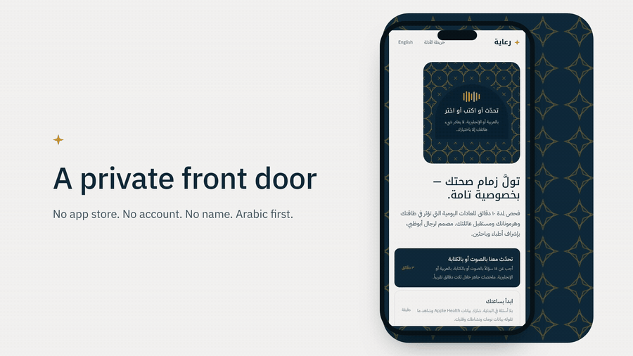
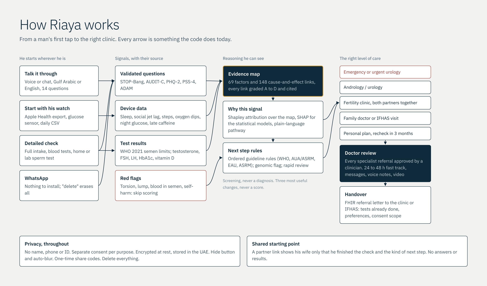
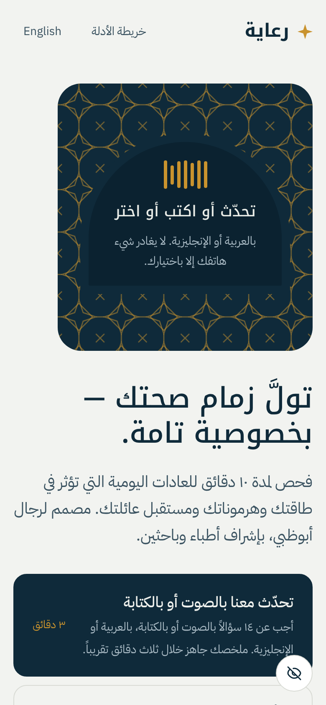
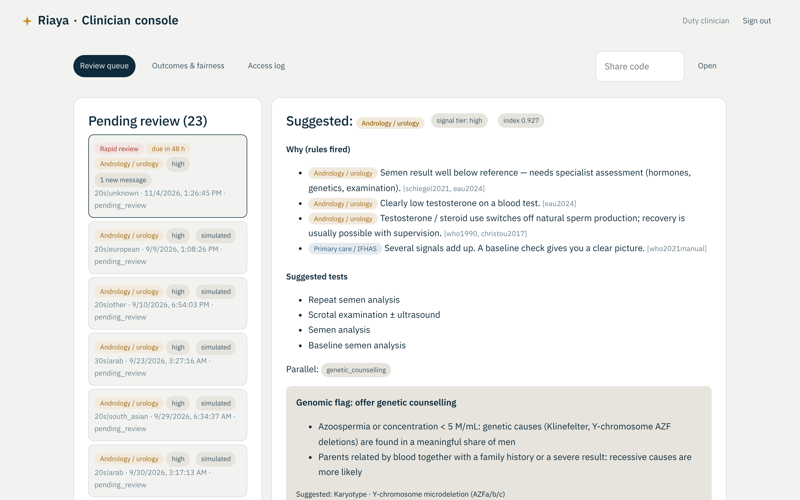

# Riaya (رعاية)

**A private front door to men's reproductive health, built for Abu Dhabi.**

Men in Abu Dhabi usually reach fertility care late: after months of trying, and after their wife has already been assessed. Riaya lets a man check the everyday things that affect his reproductive health privately, in Arabic or English, by voice, chat, his watch or WhatsApp. It explains every signal with published evidence and sends him to the right level of care, with a licensed doctor approving every specialist referral and a structured hand-off into the IFHAS screening programme.



**Watch the full demo (2:38, narrated):** [docs/media/riaya-demo.mp4](docs/media/riaya-demo.mp4)

## How it works



| What a man sees | What a doctor sees |
|---|---|
|  |  |

## Ways in

| Path | What happens | Where in the code |
|---|---|---|
| Talk it through | 14 questions by voice or chat. Understands Gulf Arabic, standard Arabic and English replies, including spoken numbers. Hands-free mode reads each question aloud and listens for the answer. | `web/chat.html`, `web/js/chat.js`, `web/js/nlu.js`, `web/js/voice.js` |
| Start with his watch | Reads an Apple Health export (or glucose sensor / daily CSV) and explains what sleep, activity, oxygen and glucose already show, before any question. A sample export is included. | `backend/app/wearables.py`, `/api/assessments/{id}/passive` |
| Detailed check | Full intake with validated instruments, blood tests, home or lab sperm test. | `web/js/app.js`, `backend/app/questionnaire.py` |
| WhatsApp | The same check over WhatsApp via Twilio. The phone number is never stored, only a salted hash, and "delete" erases everything. A WhatsApp-style demo runs without a phone. | `backend/app/conversation.py`, `/api/whatsapp/twilio`, `web/whatsapp.html` |

**Voice.** Listening uses the phone's own speech recognition (iPhone Safari, Android Chrome, Samsung Internet, Edge). In private mode, or where the browser has none (e.g. Firefox), it runs **Whisper**, OpenAI's open-source speech model, inside the browser with transformers.js, so the audio never leaves the phone. Questions are read aloud with the phone's own voices, and he chooses the voice.

## New in 2.0

- **Lab report reader:** upload a semen-analysis or hormone report (PDF, text, or a photo read on the phone). Riaya extracts each value with its unit, reference range and date, flags implausible values, and saves nothing until he confirms. The file is never kept.
- **Explained findings:** every finding has an observation, why it matters (a pathway in the evidence map), the evidence grade and sources, one recommendation, and its limitations. Unknown data is shown as unknown, never as normal.
- **Contradiction checks:** for example, reported sleep against the watch, "no diabetes" against an HbA1c of 6.9%, or low testosterone with suppressed LH when no steroid use was reported. These are flagged for a gentle conversation, never auto-resolved.
- **His own baseline:** his last week compared with his earlier weeks, not just population cut-offs.
- **What-if simulator:** an educational scenario showing how much of today's signal comes from the habits he chooses to change. It is not a fertility prediction.
- **My Reproductive Health Journey:** every check, tests already done, the next step, what changed since last time, and a follow-up reminder. He can report "booked", "went" or "couldn't go", and why.
- **Clinician workspace:** three panels (patient, clinical review, actions), with an evidence explorer on every factor, test reconciliation, a reason required for any override, and closed-loop referral tracking.
- **Programme dashboard:** an aggregated, k-anonymised dashboard for ADPHC and DoH covering the funnel, time to care, population drivers, barriers and fairness.

## What is inside

- **Evidence map** (`knowledge/graph.json`): 69 factors, 148 cause-and-effect links, each graded A–D and cited (95 sources, listed with links in [docs/REFERENCES.md](docs/REFERENCES.md)). It also holds 23 measurable signals with thresholds and 8 red flags. The server refuses to start if any link lacks a source.
- **Explainability**: Shapley attribution over the evidence map; a gradient-boosting model with a SHAP waterfall; a logistic model trained on real data (UCI Fertility, n=100) as a second opinion for doctors.
- **Triage**: ordered guideline rules (WHO 2021, AUA/ASRM 2021, EAU 2024, ASRM 2020). Red flags override everything. Genomic flag (karyotype, AZF, CFTR). Rapid review with a 24–48 h target.
- **Doctor console**: priority queue with SLA timers, explanations, approve or change the referral, encrypted messages, **voice notes both ways**, video room, FHIR handover letter, outcome and fairness dashboard, access log.
- **Privacy**: no name, phone or ID; separate consent per purpose; encryption at rest; hide button and auto-blur in the app switcher; one-time share codes; a partner link that shows only status; delete and export everything. Installable as an app (PWA) with no app store.
- **IFHAS hand-off**: FHIR R4 bundle (questionnaire response, observations with LOINC codes, service request).

## Results

From [validation/REPORT.md](validation/REPORT.md):
- **Rule check, not accuracy:** on 26 scenarios written by the team from WHO, AUA/ASRM and EAU guidance, the triage rules gave the expected next step 26 times, with 0 under-triage. This shows the rules behave as designed. Clinical accuracy needs independent review by UAE clinicians, which is the first pilot step.
- Real data (UCI Fertility, n=100): AUC 0.62–0.69.
- Simulated cohort of 20,000 men with literature effect sizes: AUC 0.68, with calibration and subgroup fairness tables.
- The untrained evidence map alone ranks outcomes with AUC 0.66, which shows the map and the literature agree.

The report also states the limits plainly: the test cases were written by the same team, the cohort is simulated, and the real dataset is small.

## Run it

```bash
python3 -m venv .venv && .venv/bin/pip install -r requirements.txt
.venv/bin/uvicorn app.main:app --app-dir backend --port 8000
```

Open http://localhost:8000. To enable the local-only demo clinician account, set `RIAYA_ENABLE_DEMO_CLINICIAN=true` before starting the server; the demo login is `clinician` / `demo-clinician`. Never enable this on a public deployment. Also `/chat.html`, `/whatsapp.html`, `/graph.html`, `/fabric.html`, and API docs at `/api/docs`.

```bash
.venv/bin/python -m pytest -q                               # 23 end-to-end tests (SQLite; set DATABASE_URL to run on Postgres)
.venv/bin/python validation/run_validation.py --seed-demo   # validation report + simulated cases for the console
```

**Deploy:** `render.yaml` deploys the app to Render without seeding simulated cases or creating a default clinician account. Before any real pilot, configure a managed Postgres database (`DATABASE_URL`), a strong unique `RIAYA_CLINICIAN_USER` and `RIAYA_CLINICIAN_PASSWORD`, and a securely generated `RIAYA_DATA_KEY`. The free Render filesystem is ephemeral; do not rely on local SQLite for durable records. Do not collect real patient data until UAE hosting, health-data compliance, clinical governance and security review are confirmed. Optional settings:

| Setting | Purpose |
|---|---|
| `DATABASE_URL` | Postgres instead of SQLite |
| `RIAYA_DATA_KEY` | Encryption key |
| `RIAYA_CLINICIAN_USER` | Doctor console username (required to provision an account) |
| `RIAYA_CLINICIAN_PASSWORD` | Doctor console password (required to provision an account) |
| `RIAYA_ENABLE_DEMO_CLINICIAN` | Local demo only; explicitly enables the non-production demo credentials |
| `TWILIO_AUTH_TOKEN` | Verify WhatsApp webhooks |
| `RIAYA_WHATSAPP_NUMBER` | Show a QR code on the WhatsApp page |
| `RIAYA_PUBLIC_URL` | Public address used in links |
| `RIAYA_VIDEO_BASE` | Self-hosted video server |

## Docs

- [docs/RESEARCH_VERIFICATION.md](docs/RESEARCH_VERIFICATION.md): every claim checked, including corrections to the brief
- [docs/REFERENCES.md](docs/REFERENCES.md): all 95 sources with links and what each one supports
- [docs/CULTURAL_DESIGN.md](docs/CULTURAL_DESIGN.md): each cultural and religious barrier, and how the product handles it
- [docs/SYSTEM_LAYERS.md](docs/SYSTEM_LAYERS.md): the gaps Abu Dhabi has named, mapped to working features
- [docs/PRIVACY_AND_REGULATION.md](docs/PRIVACY_AND_REGULATION.md): UAE rules and the controls in the code
- [docs/IFHAS_AND_ROADMAP.md](docs/IFHAS_AND_ROADMAP.md): integration, referral levels, pilot roadmap
- `demo/`: the scripts that record and assemble the demo video from the live app (narration by Kokoro, an open-source voice model)
