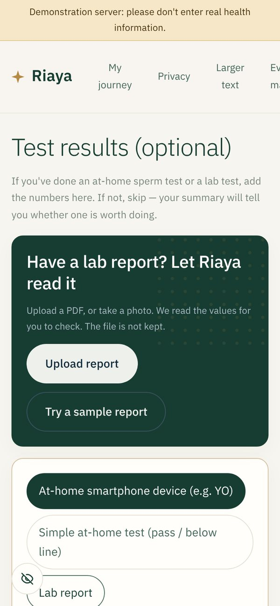

# Riaya (رعاية)

**A private front door to men's reproductive health, built for Abu Dhabi.**

Men in Abu Dhabi usually reach fertility care late: after months of trying, and after their wife has already been assessed. Riaya lets a man check the everyday things that affect his reproductive health privately, in Arabic or English, by voice, chat, his watch or WhatsApp. It explains every signal with published evidence. It then sends him to the right level of care, with a licensed doctor approving every specialist referral. The coordinator books the clinic visit and it is followed through to attendance. It is a screening tool, not a diagnosis.


**Watch the full demo (2:38, narrated):** [docs/media/riaya-demo.mp4](docs/media/riaya-demo.mp4)

## How it works


1. **He checks privately.** Voice, chat, form, watch data or WhatsApp. He gives no name, phone number or ID.
2. **Riaya explains.** Every signal links to graded, cited evidence. Missing data is shown as unknown, never as normal.
3. **A doctor approves.** Guideline rules suggest a level of care, and a licensed doctor approves or changes it. A reason is required for any change.
4. **Care Connect books the visit.** He picks a clinic, and a coordinator agrees a time with that clinic. He gets a discreet calendar entry, and his summary goes to the clinic with a one-time code.
5. **The loop closes.** Attendance, missed visits and the reasons for them feed the clinician and programme dashboards.

## Features

Every screenshot below is from the running app, captured by `demo/screenshots.js` against a fresh database (`node demo/screenshots.js <out-dir>` with the server running).

### For the man

| Feature | What it does | Screenshot |
|---|---|---|
| **Arabic-first landing** | Arabic by default with one-tap English, and wording chosen with cultural and religious sensitivity in mind ([docs/CULTURAL_DESIGN.md](docs/CULTURAL_DESIGN.md)). A banner warns that the public demo is not UAE-hosted. |  |
| **Plain-language consent** | What is kept, what is never done, and a separate choice for each purpose: doctor review, device data and research. |  |
| **Voice and chat check** | 14 questions by voice or text. Understands Gulf Arabic, standard Arabic and English, including spoken numbers. Uses the phone's own speech recognition, or Whisper running on the phone, so audio never leaves it. |  |
| **Detailed check** | Validated instruments: PSS-4, PHQ-2, AUDIT-C, STOP-Bang, ADAM. Each field shows its unit and plausible range, and errors are written in plain language. |  |
| **Watch and sensor data** | Apple Health export, Dexcom or Libre glucose CSV, or a daily CSV. Only a summary is kept, compared with his own baseline. |  |
| **Lab report reader** | Upload a semen-analysis or hormone report (PDF, text or photo). OCR runs on the phone. Each value comes with its unit, reference range and date, and nothing is saved until he confirms it. |  |
| **Private summary** | The next step, with an explanation for each finding: observation, why it matters, evidence grade, sources, one recommendation and its limits. Also shows contradiction checks and a what-if simulator. |  |
| **My journey** | Every check, what changed since last time, tests already done, a timeline of steps, and a follow-up reminder. |  |
| **Care Connect: choose a clinic** | Opens only after a doctor approves. Shows only clinics that offer the care his referral needs, using public facts from each clinic's own website. A clinic counts as confirmed only once the team has spoken to it. No availability is invented. He states his preferred times and how to reach him. |  |
| **Care Connect: request sent** | Gives him a one-time handover code for the clinic, valid 14 days. He can cancel at any time. |  |
| **Care Connect: confirmed** | Shows the date, place and handover code. The calendar file says only "Appointment", so nothing private appears on a lock screen. "I went" or "I couldn't go" with a reason; a missed visit reopens the choice. |  |
| **Privacy and sharing** | Change or withdraw consent at any time. Withdrawing doctor review removes his checks from every doctor's view. Also: a recovery code for a new phone, download everything, delete everything. |  |
| **Partner link** | A link only he can create. It shows his wife that he has taken the step, never his answers or results. It expires in 30 days and he can revoke it. |  |
| **WhatsApp** | The same check over WhatsApp through Twilio. The number is stored only as a salted hash, and sending "delete" erases everything. A demo runs without a phone. |  |
| **Clothing check** | Type or photograph a care label to see how much of the garment may warm the groin, with the strongest evidence for each fibre. |  |

### For doctors and coordinators

| Feature | What it does | Screenshot |
|---|---|---|
| **Secure sign-in** | PBKDF2 passwords. Lockout after 5 failed attempts. Sessions last 8 hours, or end after 30 minutes idle. No default account in deployment. |  |
| **Review workspace** | A priority queue with timers for when each review is due. Three panels: patient, clinical review, actions. An evidence explorer for every factor. Approve, change or reject; a reason is required for any change. Also encrypted messages and voice notes both ways. |  |
| **Appointment requests** | Each request shows the clinic, level of care, his preferred times, how to contact him and the handover code. Confirm the time agreed with the clinic, or decline with a reason, which tells him to choose again. |  |
| **Confirmed visits** | Mark each confirmed visit as attended, or as missed with a reason. |  |
| **Clinic directory** | Add a clinic with only its public facts. Confirm it with a note saying how it was checked, which patients then see. Hide a clinic from patients. |  |
| **Outcomes and fairness** | Completion, time to review and time to evaluation. Results by age and background. Care Connect booking and attendance rates, and why visits did not happen. |  |
| **Access log** | Every sign-in, failure, lockout, case view and decision. Doctors can change their password, which ends their other sessions. |  |
| **Programme dashboard** | Aggregated and k-anonymised (no group smaller than 5) for ADPHC and DoH: funnel, time to care, population drivers, barriers and fairness. Simulated cases are excluded by default. |  |
| **Evidence map** | 69 factors and 148 cause-and-effect links, each graded A–D and cited, from 95 sources. The server refuses to start if any link lacks a source. |  |

### Behind the screens

| Capability | Detail | Code |
|---|---|---|
| Triage | Ordered guideline rules (WHO 2021, AUA/ASRM 2021, EAU 2024, ASRM 2020). Red flags override everything. Genomic flag (karyotype, AZF, CFTR). Rapid review targeted at 24–48 h. | `backend/app/triage.py` |
| Explainability | Shapley attribution over the evidence map; a gradient-boosting model with SHAP; a logistic model on real data (UCI Fertility, n=100) as a second opinion. | `backend/app/assessment.py`, `ml.py` |
| Contradiction checks | Reported sleep against the watch, "no diabetes" against HbA1c, low testosterone with suppressed LH when no steroid use was reported. Each is shown, never silently hidden. | `backend/app/recommend.py` |
| IFHAS and FHIR hand-off | FHIR R4 bundle: QuestionnaireResponse, Observations with LOINC codes, ServiceRequest. | `backend/app/ifhas.py`, `handover.py` |
| Care Connect | Clinic directory, appointment requests, coordinator decisions, a discreet `.ics` calendar file, and attendance with reasons. | `backend/app/care.py` |
| Privacy controls | Encryption at rest (Fernet). Separate consent per purpose. One-time share codes. Device links expire after 180 days idle. Hide button and auto-blur in the app switcher. | `backend/app/security.py`, `web/js/common.js` |
| Safe uploads | Files are read in chunks with size limits, and over-compressed archives are refused. | `backend/app/main.py`, `wearables.py` |
| Installable app | PWA with an offline app shell. Health data is never cached. | `web/manifest.webmanifest`, `web/sw.js` |

## Tech stack

| Layer | Technology |
|---|---|
| Backend | Python 3.11, FastAPI 0.162, Uvicorn, Pydantic validation with plain-language errors |
| Database | PostgreSQL 16 via psycopg 3 in deployment; SQLite for local runs. One adapter with automatic migrations (`backend/app/db.py`) |
| Security | `cryptography` (Fernet) for encryption at rest, PBKDF2-SHA256 passwords, Content-Security-Policy, HSTS |
| Machine learning | scikit-learn 1.9 (gradient boosting, logistic regression), SHAP 0.54, NumPy, pandas, joblib |
| Documents | pypdf for lab-report PDFs, tesseract.js 5 (Arabic and English OCR, on the phone) |
| Voice | Web Speech API, with Whisper through transformers.js 3 running in the browser as a fallback |
| Frontend | Plain HTML, CSS and JavaScript (no build step). Self-hosted Noto Kufi Arabic and IBM Plex fonts. RTL-first layout |
| Messaging | Twilio WhatsApp webhook with signature validation |
| Interoperability | FHIR R4, LOINC |
| Testing and CI | pytest (30 end-to-end API tests), Playwright for UI checks, GitHub Actions on SQLite and Postgres |
| Deployment | Render blueprint (`render.yaml`) with managed Postgres and generated secrets |

## Results

From [validation/REPORT.md](validation/REPORT.md):
- **Rule check, not accuracy:** the team wrote 26 scenarios from WHO, AUA/ASRM and EAU guidance. The triage rules gave the expected next step in all 26, with no case sent to a lower level of care than expected. This shows the rules behave as designed. Clinical accuracy needs independent review by UAE clinicians, which is the first pilot step.
- **Real data** (UCI Fertility, n=100): AUC 0.62–0.69.
- **Simulated cohort** of 20,000 men using effect sizes from the literature: AUC 0.68, with calibration and subgroup fairness tables.
- **Evidence map alone**, with no training, ranks outcomes with AUC 0.66, which shows the map and the literature agree.

The report states the limits plainly:
- the test cases were written by the same team;
- the cohort is simulated;
- the real dataset is small.

## Run it

```bash
python3 -m venv .venv && .venv/bin/pip install -r requirements.txt
```

```bash
RIAYA_ENABLE_DEMO_CLINICIAN=true .venv/bin/uvicorn app.main:app --app-dir backend --port 8000
```

Open http://localhost:8000. The doctor console is at `/clinician.html`. With `RIAYA_ENABLE_DEMO_CLINICIAN=true` the demo login is `clinician` / `demo-clinician`; never enable it on a public deployment. The API docs are at `/api/docs`.

```bash
.venv/bin/python -m pytest -q
```

```bash
.venv/bin/python validation/run_validation.py --seed-demo
```

The first runs the end-to-end tests; set `DATABASE_URL` to run them on Postgres. The second writes the validation report and adds simulated cases to the console.

**Deploy:** `render.yaml` deploys to Render with:

- a managed Postgres database;
- a generated encryption key and phone-hash salt;
- a health check at `/api/health`.

It does not create a default clinician account; Render asks for `RIAYA_CLINICIAN_USER` and `RIAYA_CLINICIAN_PASSWORD`. Do not collect real patient data until all of these are confirmed:

- UAE hosting (`RIAYA_UAE_HOSTED=true` only then);
- health-data compliance;
- clinical governance;
- security review.

Settings, backups and restores are covered in [docs/OPERATIONS.md](docs/OPERATIONS.md).

| Setting | Purpose |
|---|---|
| `DATABASE_URL` | Postgres instead of SQLite |
| `RIAYA_DATA_KEY` | Encryption key; keep it apart from backups |
| `RIAYA_CLINICIAN_USER`, `RIAYA_CLINICIAN_PASSWORD` | First doctor account (only created if the password is strong) |
| `RIAYA_UAE_HOSTED` | `true` only on a UAE deployment approved for health data; removes the demo banner |
| `RIAYA_VIDEO_BASE` | Self-hosted video service; video stays off without it |
| `TWILIO_AUTH_TOKEN`, `RIAYA_WHATSAPP_NUMBER`, `RIAYA_PUBLIC_URL` | WhatsApp channel |

## Docs

- [docs/RESEARCH_VERIFICATION.md](docs/RESEARCH_VERIFICATION.md): every claim checked, including corrections to the brief
- [docs/REFERENCES.md](docs/REFERENCES.md): all 95 sources, with links and what each one supports
- [docs/CULTURAL_DESIGN.md](docs/CULTURAL_DESIGN.md): each cultural and religious barrier, and how the product handles it
- [docs/SYSTEM_LAYERS.md](docs/SYSTEM_LAYERS.md): the gaps Abu Dhabi has named, mapped to working features
- [docs/PRIVACY_AND_REGULATION.md](docs/PRIVACY_AND_REGULATION.md): UAE rules and the controls in the code
- [docs/OPERATIONS.md](docs/OPERATIONS.md): hosting, configuration, backup and restore, retention
- [docs/IFHAS_AND_ROADMAP.md](docs/IFHAS_AND_ROADMAP.md): integration, referral levels, pilot roadmap
